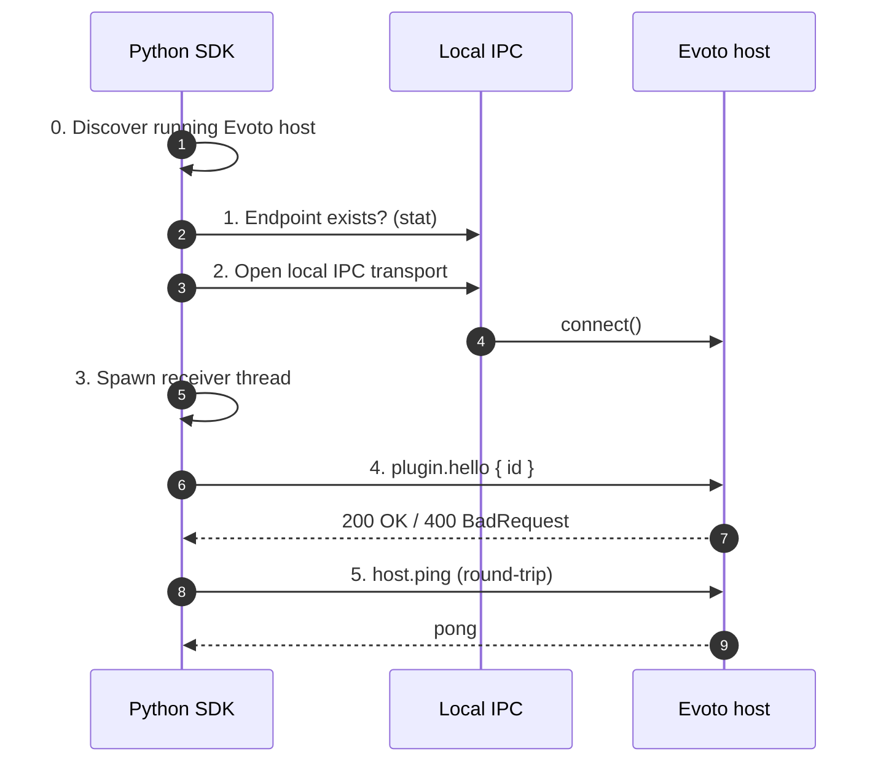

# Connection Handshake

`evoto.connect()` looks like a single call but does six discrete things
under the hood. When something goes wrong (the host reports
`Plugin connected` but Python looks stuck, or you get a 400 on the
first RPC) it is almost always one specific step that failed.

## The six steps



| Step | What it does | Most common failure |
|---|---|---|
| 0 | Discover the local Evoto host endpoint automatically. | Evoto is not running. |
| 1 | `Client._host_endpoint_exists(path)` checks if the local endpoint is listening. | Evoto not running, or stale local endpoint. |
| 2 | Opens the local IPC transport. | Permissions or stale local endpoint. |
| 3 | Receiver thread pulls bytes and feeds the JSON-RPC decoder. | Almost never fails standalone; failures here surface as step 4 timeouts. |
| 4 | `plugin.hello` registers the plugin id from `plugin.json`. | Empty `id` in `plugin.json` -> host returns 400 BadRequest immediately. |
| 5 | `host.ping` is the SDK's "is the link actually bidirectional?" sanity check. | If 1-4 pass but 5 hangs, the receiver thread is alive but the host failed to schedule responses. |

Step 0 needs a host to find. Evoto can be started normally or in the
background with `-silent`; a plugin may also spawn the silent host
itself and wait for the endpoint with `evoto.host.wait_for_host()` - see
the [Silent mode guide](silent-mode.md).

## Diagnosing a stuck connection

A short troubleshooting script is the quickest way to walk every step
above with timing prints. The minimum reproducer:

```python
import logging
import time

import evoto

logging.basicConfig(level=logging.INFO)

t0 = time.time()
evoto.connect(timeout=15.0)
print(f"connected in {time.time() - t0:.2f}s")

print("host.ping ->", evoto.host.call("host.ping", {}, timeout=5.0))
print("host.version ->", evoto.host.call("host.version", {}, timeout=5.0))

evoto.shutdown()
```

Do not run the script under a Qt event loop while debugging - any bug
in the synchronous chain above is much easier to spot when the
connect, ping, and version calls happen one after the other on the
main thread.
