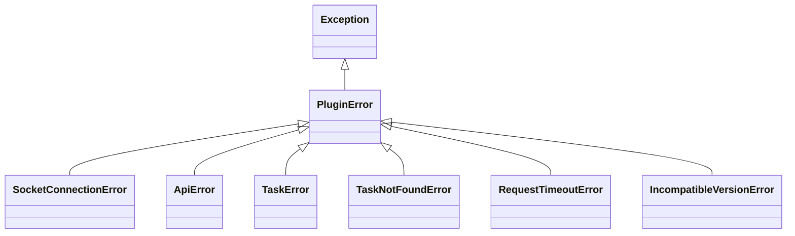

# Error Handling

The SDK turns wire-level RPC failures into Python exceptions and
provides a small enum of HTTP-style error codes so plugin code can
branch on them without parsing strings.

## Exception hierarchy



| Exception | Raised when | Typical handling |
|---|---|---|
| `SocketConnectionError` | Transport failure: host endpoint unavailable, peer closed, write/read failed. | Reconnect, or surface a "host not running" message to the user. |
| `ApiError(code, message)` | Host responded with a non-success status. Carries an `ApiErrorCode` and message. | Branch on `code`; fall through to `raise` if you do not know how to recover. |
| `RequestTimeoutError` | An RPC did not get a reply within its timeout. | Retry with backoff, or treat as failure. |
| `TaskNotFoundError` | The host asked the plugin to run a task name that is not registered. | Logged automatically; usually surfaces only in test setups. |
| `TaskError` | A task callback raised. The original exception is chained. | Inspect `__cause__`; mirror as plugin-level error. |
| `IncompatibleVersionError` | SDK and host advertise incompatible API versions. | Tell the user to upgrade Evoto or the SDK. |

These are all importable from `evoto.core._internal.exceptions`. For
day-to-day plugin code the only one most authors catch explicitly is
`ApiError`.

## Error codes

The host returns HTTP-style status codes:

| Code | Constant | Meaning |
|---|---|---|
| 400 | `ApiErrorCode.BAD_REQUEST` | Caller sent an unparseable / invalid request (bad params, missing required field, empty `plugin.hello` id). |
| 401 | `ApiErrorCode.UNAUTHORIZED` | Auth token mismatch. Plugin process spawned with the wrong `EVOTO_PLUGIN_AUTH_TOKEN`. |
| 403 | `ApiErrorCode.FORBIDDEN` | Authenticated, but the operation is not allowed in this build / state. |
| 404 | `ApiErrorCode.NOT_FOUND` | Resource missing - no current project, image id does not exist, unknown command. |
| 410 | `ApiErrorCode.GONE` | Resource existed but was just deleted; the SDK never retries 410. |
| 412 | `ApiErrorCode.PRECONDITION_FAILED` | Operation rejected because of state - e.g. silent-mode-only RPC fired without `-silent`. |
| 500 | `ApiErrorCode.INTERNAL_ERROR` | Host crashed mid-call. Bug worth a Sentry hit. |
| 503 | `ApiErrorCode.SERVICE_UNAVAILABLE` | Host is alive but a dependency (DB, plugin manager) is offline. |
| 504 | `ApiErrorCode.GATEWAY_TIMEOUT` | Host's downstream operation timed out. |

```python
from evoto.core.api_error_code import ApiErrorCode
from evoto.core._internal.exceptions import ApiError

try:
    project = evoto.project.current()
except ApiError as e:
    if e.code == ApiErrorCode.NOT_FOUND:
        print("No project is open - tell the user to open one first.")
    else:
        raise
```

## Async call status

Async callbacks receive a `ReplyStatus` alongside the result, with
timing and outcome metadata:

::: evoto.core._internal.exceptions.ReplyStatus
    options:
      heading_level: 3
      show_root_heading: false
      show_root_toc_entry: false
      show_source: false

`is_success=False` plus a non-zero `error_code` is the async
counterpart of synchronous `ApiError`.

## Best practices

- Never `except Exception:` blindly inside an event callback - the
  `evoto-event` worker logs and swallows callback exceptions, but you
  lose the chance to surface anything useful in the UI. Catch
  `ApiError` (and `RequestTimeoutError` if you issue RPCs from
  callbacks) and re-raise the rest.
- Use `try/except ApiError` rather than checking host-side return
  payload shape - the SDK has already done that work.
- For long pipelines (`watcher` -> `import` -> `export`), record the
  failed step plus its `ApiError.code` in your own state machine so
  retries are deterministic.
