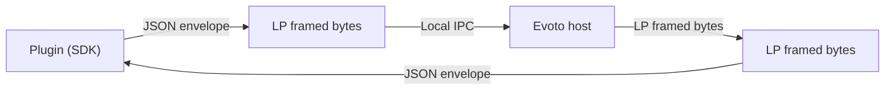

# IPC Protocol

The SDK and the Evoto host communicate over a single, full-duplex local
IPC endpoint - never TCP, never network. This page documents the wire
format, framing, and authentication.

## Wire format: JSON-RPC 2.0 with framing



Each message is a JSON object encoded as UTF-8, then prefixed with a
length header so the receiver can pull exactly one message at a time
out of the stream.

| Frame field | Bytes | Purpose |
|---|---|---|
| Magic | 4 | Constant signature so a desynced reader can resync. |
| Version | 1 | Frame format version (currently `1`). |
| Flags | 1 | Bitset reserved for future use (compression, binary, etc.). |
| Length | 4 (big-endian) | Number of bytes in the JSON payload. |
| Payload | N | The JSON envelope itself. |

The codec lives in `evoto/core/_internal/packet_codec.py`; do not bypass
the SDK transport layer.

### Envelope

```json
{
  "type": "request" | "response" | "event",
  "id": "<request id, request/response only>",
  "method": "<rpc command, request only>",
  "params": { ... },
  "result": { ... },
  "error": { "code": 400, "message": "..." }
}
```

Plugin authors never see this envelope - the SDK builds and parses it.
Documented here so you can debug a packet capture if you ever need to.

## Transport: Local IPC

The SDK talks to the Evoto host over a local IPC endpoint. The host
chooses the platform transport and the SDK connects to it automatically.
Plugin authors do not need to configure or inspect the endpoint.

## Authentication

The host injects an auth token into every plugin process it spawns:

| Variable | Purpose |
|---|---|
| `EVOTO_PLUGIN_AUTH_TOKEN` | One-shot opaque token. The SDK passes it back during `plugin.hello`. |

If the host launched your plugin (the normal case), the SDK handles
authentication automatically. If you run a script manually, call
`evoto.connect()` and let the SDK discover the running host.

## Backpressure and flow control

- The SDK serialises sends per-connection - a single `_send_lock`
  guards the writer thread.
- Inbound bytes are buffered in `bytearray` chunks and parsed
  incrementally; partial frames stay in the buffer until complete.
- The `evoto-event` worker reads delivered events from a FIFO queue.
  If your plugin produces events slower than it consumes them the
  queue grows unbounded - in practice this is not an issue because
  events are small dicts and the host paces itself.

If you need fan-out beyond a single plugin process, run more plugin
processes rather than trying to multiplex one connection.
