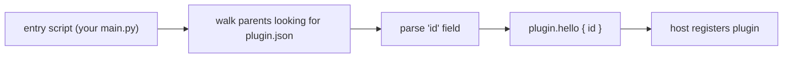

# Plugin Manifest (`plugin.json`)

Every Evoto plugin ships a `plugin.json` next to its entry script. The
file is the host <-> plugin contract: the host parses it the moment it
spawns the plugin process, and the SDK reads it again from inside the
plugin so it can send the right id during the handshake.

## Schema

| Key | Required | Type | Default | Meaning |
|---|---|---|---|---|
| `id` | **yes** | string | - | Stable plugin identifier (e.g. `evoto.demo.runtime`). The host uses this for `plugin.hello`; an empty value makes the host return 400 BadRequest. |
| `name` | recommended | string | `id` | Human-readable display name. |
| `version` | recommended | string | `0.0.0` | Semantic version of the plugin itself. |
| `description` | optional | string | empty | One-line summary surfaced in plugin pickers. |
| `entry` | optional | string | `main.py` | Python file the host launches. Resolved relative to the manifest. |
| `python` | optional | object | empty | Python interpreter / version constraints (host-defined). |
| `dependencies` | optional | array  | empty | Extra packages the host should ensure are importable. |

These key names form the host <-> plugin contract; the same names are
defined in `evoto/core/ipc_constants.py` on the SDK side.

## Minimum viable manifest

```json
{
  "id": "your.org.your-plugin",
  "name": "Your Plugin",
  "version": "0.1.0",
  "entry": "main.py"
}
```

That is enough for the host to spawn `main.py` and the SDK to complete
`plugin.hello`. Everything else is metadata.

## Realistic example

From `demo/runtime_demo/plugin.json`:

```json
{
  "id": "evoto.demo.runtime",
  "name": "Plugin Runtime Demo",
  "version": "0.1.0",
  "description": "Exercises host lifecycle helpers.",
  "entry": "main.py"
}
```

## How the SDK uses it

`evoto.connect()` walks up the directory tree from the entry script,
finds the nearest `plugin.json`, and parses out the `id` field. That
`id` is what gets sent to the host as the `plugin.hello` argument:



If the manifest is missing or `id` is empty, the SDK logs an error and
the host returns `400 BadRequest`. Always commit a `plugin.json`
alongside your entry script.

## Versioning policy

- The `version` field is **the plugin author's** version, not the
  SDK's. Bump it when you ship a behavioural change to your users.
- The host's API version is tracked separately and can be queried through
  `evoto.host.call("host.version", {})`. If a
  backwards-incompatible API bump happens you need a newer SDK, not a
  manifest change.

## Co-locating with the entry script

Convention: keep `plugin.json` and `main.py` in the same directory.

```
my_plugin/
  plugin.json
  main.py            <- referenced by `entry`
  helpers.py
```

If you must put the manifest somewhere else, set `entry` to a path
relative to the manifest:

```json
{
  "id": "your.org.layered",
  "entry": "src/my_plugin/main.py"
}
```
