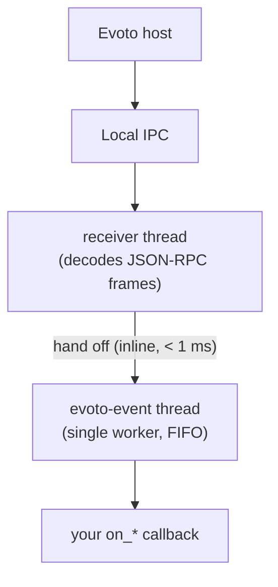

# Threading Model

Every `evoto.*.on_*` helper (e.g. `evoto.project.on_changed`,
`evoto.image.subscribe`, `evoto.watcher.*`) ends up calling
`client.on(event, callback)`. Understanding which thread your callback
runs on keeps you out of the common deadlock and UI-update traps.

## How events get to your callback



Three threads are involved, but **only the third one is yours**:

1. **Receiver thread** - owned by the SDK. Decodes the wire frames.
   Never blocks on user code.
2. **`evoto-event` thread** - owned by the SDK. A single worker that
   pulls events off a FIFO queue and calls your callbacks one at a
   time, in arrival order.
3. **Your callback** - runs on the `evoto-event` thread, **not** on
   the GUI main thread, **not** on the receiver thread.

This means:

- A slow callback delays the *next* event for this plugin but never
  stalls `plugin.ping` or in-flight RPC responses.
- Delivery order to callbacks matches the order the host pushed them.
- Two callbacks for the same plugin never run concurrently - they
  share a single worker thread.

## Rules of thumb

| What you want to do | Correct pattern |
|---|---|
| Call `evoto.project.list()` / other RPCs from inside a callback | Just call it. The SDK is re-entrant; no deadlock. |
| Update Qt / Tk widgets | Emit a queued signal (`Signal(...).emit(...)`) or `root.after(0, ...)`; do the UI work on the GUI thread. |
| Long compute or blocking I/O | Spawn a `threading.Thread` or push to a `queue.Queue`; keep the callback itself short. |
| Guarantee callbacks don't block each other | Don't wait for another event inside a callback - they share a thread. |
| Stop receiving events | Hold the disposer returned by `on_*`, or call the matching `off_*` / `client.off(event, cb)`. |

Exceptions raised from a callback are **logged and swallowed**; they do
not crash the plugin or unsubscribe you. Hooking `evoto.on_shutdown(...)`
is the right place to perform cleanup that must happen before the
process exits.

## Qt blueprint

The standard pattern for any Qt-based plugin: have your widget expose
a `Signal`, fire it from inside the callback, and let Qt's queued
connection deliver the payload to the GUI thread.

```python
from PySide6.QtCore import Signal
from PySide6.QtWidgets import QMainWindow
import evoto


class Window(QMainWindow):
    changed = Signal(str, object)     # event_name, payload

    def __init__(self):
        super().__init__()
        self.changed.connect(self._on_change)      # queued -> GUI thread
        self._dispose = evoto.project.on_changed(
            lambda name, data: self.changed.emit(name, data)
        )

    def _on_change(self, name, data):
        # Runs on the GUI main thread - safe to touch widgets here.
        self.refresh_tree()

    def closeEvent(self, event):
        self._dispose()
        super().closeEvent(event)
```

See `demo/project_image_demo/main.py` for a full working example.

## Common pitfalls

### Touching Qt widgets directly from a callback

```python
# BAD - cross-thread widget access. Crashes or no-ops silently
# depending on the platform / Qt version.
def _on_renamed(name, payload):
    self.label.setText(payload["name"])

evoto.project.on_renamed(_on_renamed)
```

Always go through a queued signal as in the Qt blueprint above.

### Waiting on another event inside a callback

```python
# BAD - the worker pulls one event at a time. Waiting here means
# the next event for this plugin never lands.
event_arrived = threading.Event()

def _on_completed(_):
    event_arrived.set()

evoto.export.on_completed(_on_completed)

def _on_started(_):
    event_arrived.wait(timeout=10)   # <- deadlocks the worker
```

If you need rendezvous semantics, push a "started" record to a
`queue.Queue` and have a *separate* thread consume from it.

### Heavy work inline

```python
# BAD - 500 ms of image hashing inside the callback freezes
# subsequent event delivery for this plugin.
def _on_files_added(payload):
    for path in payload["paths"]:
        compute_perceptual_hash(path)
```

Hand off to a worker thread / process pool from the callback and
return immediately.
