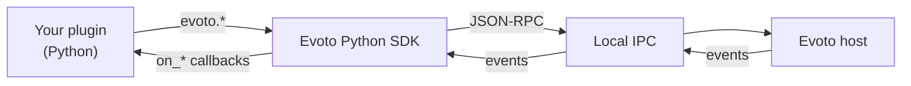

# Evoto Plugin SDK

> A Pythonic SDK for building plugins on top of the Evoto desktop host.

The Evoto Plugin SDK lets you drive the Evoto image-editing host from Python:
import images, manage projects, apply presets, run exports, watch folders, and
react to lifecycle events - all over a single JSON-RPC channel that the SDK
hides behind ergonomic APIs.

```python
import evoto

evoto.connect()

project = evoto.project.current()
print(f"Active project: {project['name']}")

evoto.shutdown()
```

## What's in this site

<div class="grid cards" markdown>

-   :material-rocket-launch: __Getting Started__

    ---

    Install the SDK, connect to a running Evoto host, and run your first
    plugin in under five minutes.

    [:octicons-arrow-right-24: Quick start](getting-started.md)

-   :material-book-open-page-variant: __Guides__

    ---

    Threading model, connection handshake, plugin manifest, error
    handling, and the IPC wire protocol.

    [:octicons-arrow-right-24: Browse guides](guides/threading-model.md)

-   :material-code-braces: __Python API__

    ---

    Auto-generated reference for `evoto.project`, `evoto.image`,
    `evoto.preset`, `evoto.export`, `evoto.watcher`, `evoto.user`,
    `evoto.metadata`, `evoto.library`, `evoto.culling`, `evoto.edit`, and
    the low-level `evoto.host` handle.

    [:octicons-arrow-right-24: Python reference](api/index.md)

</div>

## Architecture at a glance



- The SDK runs **in your Python process**; the host is the **Evoto desktop
  app** running locally.
- Communication is bidirectional: you call RPCs, the host pushes events back.
- Callbacks are dispatched on a dedicated single-threaded executor
  (`evoto-event`) - see the [threading guide](guides/threading-model.md)
  for the rules of thumb.

## Project layout

| Path | What lives here |
|------|------|
| `evoto/` | The SDK package - what plugin authors `import evoto`. |
| `demo/` | Self-contained example plugins, each with `main.py` + `plugin.json`. |
| `docs/` | This documentation site's markdown source. |
| `docs-data/` | Structured API reference data used by the API viewer. |

## Where to go next

1. New to Evoto plugins? Start with [Getting Started](getting-started.md).
2. Already have a plugin running and need a method signature? Jump straight
   to the Python API reference.
3. Hitting a deadlock or crash inside an event callback? Read the threading
   guide first, then check the connection diagnostic demo.
